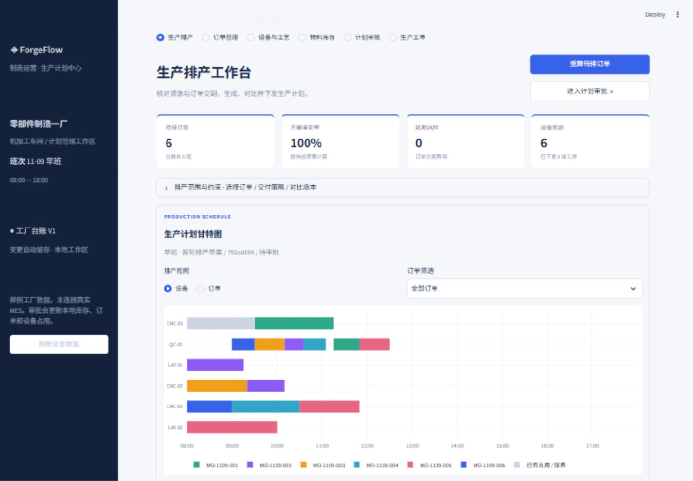
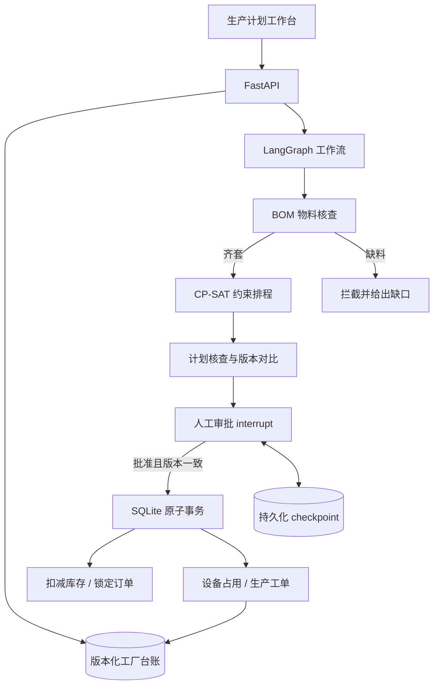

# ForgeFlow · 制造业生产计划中心

可运行的本地制造运营原型：订单台账、设备日历、物料齐套、约束排产、版本对比、人工审批和生产工单形成同一条流程。初始数据为合成数据，后续修改会持久化；未连接真实工厂系统。



## v0.2 业务能力

| 页面 | 可实际操作的内容 |
|---|---|
| 生产排产 | 默认生成首轮草案；选择待排订单、硬/软交期策略，按设备或订单查看甘特图，比较基线，导出 CSV |
| 订单管理 | 新增、编辑、搜索、筛选订单，维护数量、交期、权重；CSV 批量新增 |
| 设备与工艺 | 维护停机/保养区间与班次时长，查看设备组、产品路线与 BOM |
| 物料库存 | 核对待排订单需求、显示缺口、维护可用库存 |
| 计划审批 | 查看版本、审批记录与快照，批准下发或驳回；过期草案不能下发 |
| 生产工单 | 查看实际审批产生的本地工单、设备与工序任务，导出任务表 |

内置 6 笔订单、3 种产品、6 台设备、3 类物料、多产品工艺路线。默认班次为 **2026-11-09 08:00—18:00**，按连续可用时间建模；休息/保养请录入设备日历。时间字段使用距班次开始的分钟数。

## 启动

已在 Windows / Python 3.14.7 验证。建议使用 Python 3.14 复现。

```powershell
git clone https://github.com/knsonggg/Manufacturing-Intelligent-Agent.git
cd Manufacturing-Intelligent-Agent
powershell -ExecutionPolicy Bypass -File .\start.ps1
```

[工作台](http://127.0.0.1:8501) · [API 文档](http://127.0.0.1:8010/docs)

启动脚本创建 `.venv`、安装依赖并启动 API 与 Streamlit。保持终端运行，Ctrl+C 停止。日志见 `runtime-api*.log`。端口冲突时先检查已有服务，不要停止其他项目。

手动启动：

```powershell
python -m venv .venv --without-pip
python -m pip --python .venv\Scripts\python.exe install -r requirements.txt
# 终端 1
.venv\Scripts\python.exe -m uvicorn manufacturing.api:app --host 127.0.0.1 --port 8010
# 终端 2
.venv\Scripts\python.exe -m streamlit run ui.py --server.address 127.0.0.1 --server.port 8501
```

`requirements.txt` 固定直接依赖；`requirements-lock.txt` 为本机完整依赖快照。无需模型密钥即可使用全部工作台业务功能。

## 审批后到底发生什么

1. 方案保存所用的工厂台账版本和完整输入快照。
2. 下发前检查台账版本；订单、库存、日历等任一数据变化，旧草案均须重算。
3. 在同一个 SQLite 事务内扣减物料、将所选订单标记为已下发、写入设备占用和工单、递增版本。
4. 同一方案重复批准或 checkpoint 重放不会重复扣库存、建工单。
5. 后续排产只能选择待排订单，并避开已下发任务占用。两个并行草案中，一个下发后，另一个变成过期版本。

若事务已提交但工作流状态尚未保存，审批页会提供“恢复下发”。幂等事务确保重启重试不会再次扣料或重复生成工单。

工单状态为“已下发 / 待反馈”，没有虚构自动完工。为保护已释放资源，首版在下发后锁定本班次设备日历、工艺路线和班次时间，不支持在制重排或撤销工单。

## 排程与助手

OR-Tools CP-SAT 负责确定性计算：设备组匹配、单工序选择一台设备、设备互斥、工序先后、停机区间、已下发任务占用、班次边界。

- **交期优先**：允许延期，最小化 `加权延期 × (班次分钟数 + 1) + 最大完工时间`，优先减少加权延期。
- **交期必须满足**：增加硬交期约束，无法满足时阻止下发。
- 求解时限 5 秒，单 worker、固定随机种子；区分 OPTIMAL、FEASIBLE、INFEASIBLE 和 UNKNOWN。UNKNOWN 仅表示未找到方案，不等于已证明无解。

计划核查助手基于物料检查、排程结果和演示规程输出事实、风险及流程记录。当前摘要由规则生成，SOP 按标签检索；没有伪装成模型诊断、向量 RAG 或自主多 Agent。

原版 `/runs` 场景演示与可选 function calling 接口保留兼容。其数据独立，不更新新版工作空间。可通过 `LLM_API_KEY`、`LLM_BASE_URL`、`LLM_MODEL` 环境变量配置 Chat Completions 兼容服务；当前工作台主流程不依赖模型。在线服务未提供密钥验证。

## 架构



目录：`manufacturing/workspace.py` 为台账校验与种子；`scheduler.py` 为排程；`workflow.py` 为工作流；`store.py` 为业务事务；`api.py` 为接口；`ui.py` 为工作台；`tests/` 为业务、API 与页面测试。

## 验证

```powershell
New-Item -ItemType Directory -Path runtime -Force | Out-Null
.venv\Scripts\python.exe -m pytest -q --basetemp=runtime/pytest-local
```

新增验证包括：自定义订单影响工时和物料、库存短缺拦截、硬交期无解、版本冲突、并行草案竞争、原子下发与幂等、后续方案避开已下发资源、工厂数据重启持久化、六个页面渲染及通过界面修改订单。[五分钟演示](docs/DEMO.md) · [验证记录](docs/VALIDATION-V2.md)

## 实际落地还缺什么

这是求职作品及可扩展原型，不是已部署的工厂产品。生产接入仍需要 MES/ERP 数据适配、登录与角色权限、真实工艺校验、报工反馈，以及在制任务冻结、换型、拆批、跨班次和多工厂约束。当前只支持本地单实例；不要使用多 worker，也不要直接暴露到公网。

工作空间数据保存在被 Git 忽略的 `runtime/`。初始种子只在数据库首次创建时加载，重启不会重置用户修改。`.env`、虚拟环境、运行数据库和日志均不进入源码包。

## 参考

[OR-Tools Job Shop](https://developers.google.com/optimization/scheduling/job_shop) · [LangGraph interrupt](https://reference.langchain.com/python/langgraph/types/interrupt) · [Streamlit 数据编辑](https://docs.streamlit.io/develop/api-reference/data/st.data_editor) · [Pydantic 验证](https://docs.pydantic.dev/latest/concepts/validators/)
